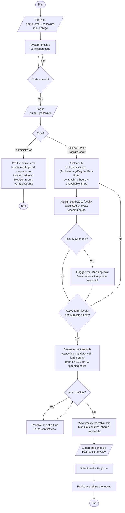

# ATLAS — System Flowchart

The main path through the system, in the order it happens.

This describes what ATLAS does today. Timetables are generated adhering to subject teaching hours, term workload limits, mandatory lunch breaks, and room allocations. Room assignment is shown as ending at the Registrar because ATLAS produces a conflict-free professor timetable and the Registrar assigns or confirms general lecture rooms from the submitted file.

## Shapes

| Shape | Meaning |
|---|---|
| Stadium — `( )` | Start / End |
| Parallelogram — `/ /` | Input or output |
| Rectangle | Process the system performs |
| Diamond | Decision |

## Notes

- **Registration** is self-service for Program Chairs only. College Deans are pre-seeded and System Administrators are created server-side.
- **A verification code** is required before an account can log in.
- **Nothing can be generated** until an administrator has set an active academic term — this is why the administrator branch feeds the chair's work.
- **Teaching load is measured in actual weekly hours** rather than academic units. Overloads are permitted but flagged for Dean approval.
- **Mandatory Lunch Break** is reserved strictly from 12:00 PM to 01:00 PM, Monday through Friday (Saturdays exempt).
- **Conflicts are resolved one at a time**, deliberately; there is no bulk auto-solve.
- **Rooms are best-effort.** A laboratory is given a free laboratory room where one exists, and left blank (`TBA`) where none is.
