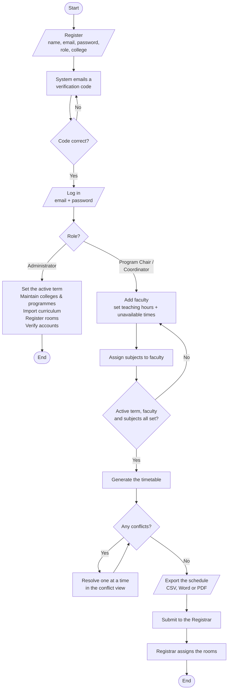

# ATLAS — System Flowchart

The main path through the system, in the order it happens.

This describes what ATLAS does today. Room assignment is shown as ending at the
Registrar because that is where it ends: ATLAS produces a conflict-free
professor timetable and the Registrar assigns the rooms from the submitted file.

## Shapes

| Shape | Meaning |
|---|---|
| Stadium — `( )` | Start / End |
| Parallelogram — `/ /` | Input or output |
| Rectangle | Process the system performs |
| Diamond | Decision |

## Notes

- **Registration** is self-service for Program Chair and Coordinator only.
  Administrator accounts are created server-side.
- **A verification code** is required before an account can log in.
- **Nothing can be generated** until an administrator has set an active academic
  term — this is why the administrator branch feeds the chair's work.
- **Conflicts are resolved one at a time**, deliberately; there is no bulk
  auto-solve.
- **Rooms are best-effort.** A laboratory is given a free laboratory room where
  one exists, and left blank where none is. A blank room is not an error — it is
  the Registrar's column to fill. Lecture subjects are never given a room.
