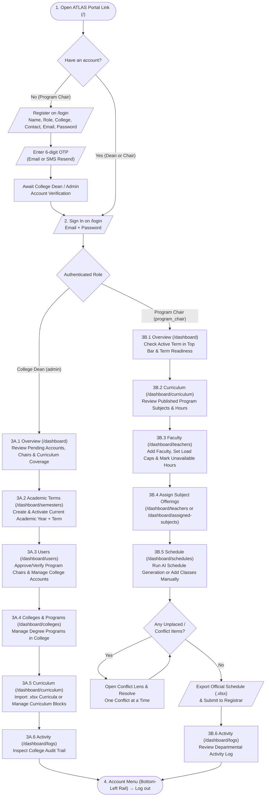

# ATLAS — College Dean & Program Chair Operational Guide

**Academic Timetabling & Load Allocation System — De La Salle Araneta University (Tertiary Education)**

This guide walks **College Deans** and **Program Chairs** through the complete end-to-end flow of using ATLAS, starting from opening the portal link through logging out, followed by reference instructions for **Profile**, **Settings**, and supporting workspace tools.

---

## End-to-End Operational Flowchart

---

# Part 1 — Step-by-Step Operational Flow (Accessing the Link to Logging Out)

## Step 1: Accessing the Portal (`/` → `/login`)

1. Open your browser and navigate to the ATLAS portal link (e.g. `http://localhost:5173/` in local development or the university-hosted URL).
2. On the **DLSAU ATLAS Landing Page**:
   - **Existing Users (College Deans & Verified Program Chairs):** Click **Sign in** in the top-right bar (or **Sign in to Portal** on the main card) to open `/login`.
   - **New Program Chairs:** Click **Register** in the top-right bar (or **Register as Program Chair** on the main card) to open the registration form on `/login`.

> [!NOTE]
> - **College Deans** do not self-register. Each college (`CAST`, `CBMA`, `COED`, `CVMAS`) has a pre-seeded Dean account (`dean.cast@dlsau.edu.ph`, `dean.cbma@dlsau.edu.ph`, `dean.coed@dlsau.edu.ph`, `dean.cvmas@dlsau.edu.ph`).
> - **Faculty members** do not log into ATLAS; their teaching load limits, subject offerings, and unavailable hours are managed as scheduling records by Program Chairs.

---

## Step 2: Account Setup, Verification & Sign-In (`/login`)

### 2.1 Program Chair Self-Registration & OTP Verification
1. On the **Join ATLAS** registration screen, fill in:
   - **First Name** and **Last Name** (letters, spaces, hyphens, apostrophes, or periods only).
   - **User Role:** `Program Chair`.
   - **Department / College:** Select your college and area (e.g. `CAST — Computer Eng & Computer Science`, `CBMA — Accountancy`, `COED — Education Programs`, `CVMAS — Agriculture`).
   - **Contact Number:** Philippine mobile number (`09XX XXX XXXX` or `+639XXXXXXXXX`).
   - **Email Address:** Your official `@dlsau.edu.ph` address.
   - **Password & Confirm Password:** `12–72` characters with no leading or trailing spaces.
2. Click **Create Account**.
3. On the **Verify Account** screen:
   - Enter the **6-digit Verification OTP** sent to your email (and/or phone).
   - If the email does not arrive, click **Resend Verification Code** or **Didn’t get the email? Send the code by SMS**.
4. Once verified, you are returned to the sign-in screen. If your account still requires College Dean clearance, wait for your Dean to verify your account in **Users**.

### 2.2 Signing In (College Dean & Program Chair)
1. Enter your **Email Address** and **Password**.
   - A warning indicator appears automatically if **Caps Lock is ON**.
   - Check **Remember me** if signing in on a private, trusted device.
2. Click **Log in to Atlas**.
   - If any field is invalid or the password is incorrect, a floating validation message box appears directly over the field with an `!` badge on its label.
3. Upon successful sign-in, ATLAS opens your configured startup page (defaults to **Overview** at `/dashboard`).

---

## Step 3A: College Dean Workflow (`admin` Scoped to College)

When signed in as a **College Dean**, the left navigation rail displays administrative sections scoped to your college (`Overview`, `Users`, `Colleges and Programs`, `Curriculum`, `Academic Terms`, and `Activity`).

### 3A.1 Check College Readiness on Overview (`/dashboard`)
1. Review the top banner and three KPI cards:
   - **Awaiting Verification:** Number of newly registered Program Chair accounts in your college waiting for Dean clearance. If any are pending, click **Review Accounts →**.
   - **Registered Accounts:** Total active accounts and Program Chairs in your college.
   - **Curriculum Coverage:** How many degree programs in your college have published curriculum blocks loaded.
2. Review the **College & Programs** table at the bottom to see which programs already have curriculum blocks and which ones need curriculum ingestion.

### 3A.2 Set or Confirm the Active Academic Term (`/dashboard/semesters`)
1. Click **Academic Terms** in the left navigation rail.
2. To create a new term:
   - Click **New Term**.
   - Enter the **Academic Year** (consecutive `YYYY-YYYY`, e.g. `2026-2027`) and choose the **Term** (`1st Term`, `2nd Term`, or `3rd Term`).
   - Click **Create Term**.
3. To make a term active across the system:
   - Open the row actions menu (`⋯`) on the target term and select **Set as active**, then confirm.
   - The top context bar immediately updates to show the active term (e.g. `AY 2026-2027 · 1st Term`).

> [!IMPORTANT]
> Program Chairs cannot generate timetables until an active academic term is set.

### 3A.3 Verify & Manage College Users (`/dashboard/users`)
1. Click **Users** in the left navigation rail.
2. Filter by **Status** (`All`, `Verified`, `Pending`) or search by name/email.
3. For pending Program Chair registrations in your college:
   - Open the row menu (`⋯`) and click **Verify account** to grant access.
4. You can also click **Add User** to create an account directly, **Edit** user details, **Reset password** (issues a temporary password), or **Delete** an account.

### 3A.4 Manage Colleges and Degree Programs (`/dashboard/colleges`)
1. Click **Colleges and Programs** in the left navigation rail.
2. Review the degree programs listed under your college.
3. Click **Add Program** to register a new degree program (enter **Program Code**, e.g. `BSCS`, and **Program Name**), or use the row menu (`⋯`) to **Edit** or **Delete** an existing program.
4. If any unassigned curriculum blocks appear, click **Assign** to bind them to the proper degree program.

### 3A.5 Import & Manage Curricula (`/dashboard/curriculum`)
1. Click **Curriculum** in the left navigation rail.
2. **To Import an Official Excel Curriculum Workbook (`.xlsx`):**
   - Click **Import Excel**.
   - Select the target **Program** and enter the **Academic Year** (e.g. `2026-2027`), then proceed to the **Curriculum Import Wizard**.
   - Upload the `.xlsx` / `.xlsm` file, review the parsed subjects (Course Code, Subject Title, Lec/Lab Units, Prerequisites, Year & Semester), and confirm the import.
   - If a curriculum block for that program and academic year already exists, choose whether to **Overwrite** or cancel.
3. **To Create or Edit a Curriculum Manually:**
   - Click **New Curriculum** to create an empty block, or click any existing curriculum card to open its detail view (`/dashboard/curriculum/:id`).
   - Inside a curriculum block, you can add/edit/remove subjects, adjust lecture/lab units, or change block status (`PUBLISHED`, `DRAFT`, `ARCHIVED`).

### 3A.6 Audit College Activity (`/dashboard/logs`)
1. Click **Activity** in the left navigation rail.
2. Filter logs by **Status** (`SUCCESS`, `WARNING`, `ERROR`), **Action**, or search keyword to audit sign-ins, curriculum imports, schedule generations, and user updates within your college.

---

## Step 3B: Program Chair Workflow (`program_chair`)

When signed in as a **Program Chair**, the left navigation rail is organized around departmental scheduling (`Overview`, `Schedule`, `Assigned Subjects`, `Faculty`, `Curriculum`, and `Activity`).

### 3B.1 Check Term Readiness on Overview (`/dashboard`)
1. Confirm the **Active Academic Term** badge in the top bar (e.g. `AY 2026-2027 · 1st Term`).
2. Check the **Term Readiness Checklist** and KPI tiles on **Overview**:
   - Active academic term configured
   - Published curriculum subjects available
   - Faculty roster added with teaching load caps set
   - Unresolved schedule conflicts count
3. Use quick actions on Overview to jump straight to **Faculty**, **Curriculum**, **Schedule**, or **Export Excel**.

### 3B.2 Review Published Curriculum (`/dashboard/curriculum`)
1. Click **Curriculum** in the left navigation rail.
2. Click your program's published curriculum block to view all subjects by **Year Level** and **Semester**, including **Lecture Units**, **Lab Units**, and computed weekly contact hours.
   - *Note:* Curriculum authoring is managed by the College Dean / Administrator; Program Chairs view published curricula as the catalog source for offerings.

### 3B.3 Add Faculty, Set Load Caps & Mark Unavailable Hours (`/dashboard/teachers`)
1. Click **Faculty** in the left navigation rail.
2. Click **Add Faculty** (or **Edit** on an existing faculty row):
   - **Full name:** Enter first name, then surname (e.g. `Juan Dela Cruz`).
   - **Employment:** Choose **Full-time** (`20–24 hrs/week required`) or **Part-time** (`Under 20 hrs/week`).
   - **Maximum Load Limit:** Toggle between **Units** (`1–18` full-time / `1–12` part-time) or **Hours (hrs)** (`1–30` full-time / `1–20` part-time) and enter the cap.
   - **Unavailable hours:** Click any day (`Mon`–`Sat`) to mark the professor unavailable. Leave **Specific hours** unchecked for all-day unavailability (`7:30 AM – 5:30 PM`), or check **Specific hours** to set exact start/end time windows (click **Add** to add multiple unavailable windows on the same day).
3. Click **Add Faculty** / **Save Changes**.
4. Click **Preview** (eye icon) on any row to inspect a faculty member's current weekly schedule and load meter.

### 3B.4 Assign Subject Offerings to Faculty (`/dashboard/teachers` or `/dashboard/assigned-subjects`)
You can assign subjects from either screen:

- **Option A — From Faculty (`/dashboard/teachers`):**
  1. Click **Assign Subjects** on a faculty member's row.
  2. Filter curriculum subjects by **Program**, **Year Level**, **Semester**, or search by code/title.
  3. Enter the **Section** name (e.g. `1A`, `CS-3A`) and click **Assign** to bind the subject to that professor for the active term.
  4. To remove an offering, click **Remove** next to the assigned subject in the dialog.

- **Option B — From Assigned Subjects (`/dashboard/assigned-subjects`):**
  1. Click **Assigned Subjects** in the left navigation rail to see the complete active-term subject list and assignment summary (`Total`, `Assigned`, `Unassigned`).
  2. Filter by **Status** (`All`, `Assigned`, `Unassigned`), **Program**, **Year Level**, or **Professor**.
  3. Click **Assign** (or **Change** on an already-assigned subject), pick a professor from your roster, and confirm.
  4. If assigning or overriding a **General Education (GenEd)** subject, confirm the prompt in the confirmation dialog.

### 3B.5 Generate the Timetable, Resolve Conflicts & Export (`/dashboard/schedules`)
1. Click **Schedule** in the left navigation rail.
2. **Generate Timetable with AI:**
   - Click **Generate Schedule**.
   - Verify the active academic term at the top of the modal. (If unassigned major subjects remain, a notice appears with a **Review Assigned Subjects** shortcut.)
   - Select the professors to include (defaults to all professors) and click **Generate Schedule**.
   - Review the post-generation summary (**Generated**, **Unplaced**, **Skipped GenEd**, and any **Teaching load warnings**).
3. **Inspect the Timetable:**
   - Toggle between the **Grid View** (Weekly Matrix across Periods 1–8, `07:30 AM – 07:30 PM`, `Mon–Sat`) and the **By-Professor Board**.
   - Filter by **Professor** or **Section** using the top filter controls.
   - Hover any class block on the grid to open the **Schedule Hover Popover** showing full subject details, section, duration, professor, and a quick **Delete Schedule** button.
4. **Add or Remove a Class Manually:**
   - Click **Create** to manually place a class: choose **Subject**, **Professor**, **Section**, **Day** (plus optional paired day), **Start Time**, and **End Time**. Live conflict checks and **AI Slot Suggestions** appear inside the modal before saving.
   - If you delete a class or click **Clear All**, an **Undo / Restore** banner appears in the bottom-right corner so you can immediately restore the previous state.
5. **Resolve Conflicts One at a Time:**
   - If unplaced items or conflicts exist, click the **Conflicts** button in the header (or click **Resolve** inside the generation results) to open the **Conflict Lens**.
   - The timetable dims unrelated classes and highlights only the clashing blocks. Resolve each item individually; each resolution is recorded in the **Activity Log** and summarized in the **Conflict Resolved** dialog.
6. **Export Official Schedule to Excel (`.xlsx`):**
   - Click **Export Excel** in the header.
   - In the **Export Schedule to Excel** dialog, choose **Faculty Scope** (current filtered professor or **All Professors**), inspect the live **Document Preview** table, and click **Download Excel (.xlsx)**.
   - Submit the downloaded DLSAU-formatted `.xlsx` workbook to the Registrar for room assignment.

### 3B.6 Review Departmental Activity (`/dashboard/logs`)
1. Click **Activity** in the left navigation rail to review recent schedule generations, conflict resolutions, and subject assignment changes in your department.

---

## Step 4: Logging Out (College Dean & Program Chair)

1. Locate the **Account Widget** at the bottom-left corner of the navigation rail (displays your avatar/initials, name, college, and role).
2. Click the **Account Widget** to open the account popup menu.
3. Click **Log out** (at the bottom of the menu).
4. ATLAS clears your local session, invalidates your server session cookie, and redirects you to `/login`.
   - *Note:* If the server could not be reached during sign-out on a shared computer, ATLAS displays a yellow notice on `/login` advising you to close the browser window to ensure the session is terminated.

---

# Part 2 — Post-Logout Reference: Profile, Settings & Workspace Tools

The following account and workspace features are accessed from the **Account Widget** at the bottom-left of the navigation rail while signed in (or from `/login` for password recovery).

## 5. Profile (`/dashboard/profile`)

Open the bottom-left **Account Widget** and select **Profile** (or press `Alt + P` from Overview):

1. **Profile Picture:**
   - Click **Change photo** (camera button) on your avatar to upload a `.jpg`, `.jpeg`, `.png`, or `.webp` image.
   - Invalid file types or empty files trigger an anchored validation popup immediately.
2. **Viewing & Editing Personal Information:**
   - Read-only institutional fields: **Email Address**, **Role**, and **Department / College**.
   - Click **Edit Profile** to update your editable fields:
     - **First Name** & **Last Name**
     - **Contact Number** (`09XX XXX XXXX` or `+639XXXXXXXXX`)
     - **Sex** (`Male`, `Female`, `Prefer not to say`)
     - **Date of Birth** (must be a valid past date within `18–100` years)
   - Click **Save Changes** to persist updates (your display name in the sidebar updates immediately), or **Cancel** to discard changes.

---

## 6. Settings (`/dashboard/settings`)

Open the bottom-left **Account Widget** and select **Settings**:

### 6.1 Workspace Preferences (Browser-Local)
- **Page to open after signing in:**
  - **College Dean:** Choose between **Overview** (`/dashboard`) and **Curriculum** (`/dashboard/curriculum`).
  - **Program Chair:** Choose between **Overview** (`/dashboard`), **Schedule** (`/dashboard/schedules`), and **Curriculum** (`/dashboard/curriculum`).
- **Table and timetable density:**
  - **Comfortable:** Taller rows, easier to scan.
  - **Compact:** More rows on screen at once (applies immediately across tables and timetables).
- Click **Save Preferences** to apply.

### 6.2 Change Password
1. Enter your **Current password**.
2. Enter your **New password** (`12–72` characters, no leading/trailing spaces, and must differ from your current password).
3. Enter **Confirm new password** (use the eye icon on any field to toggle visibility).
4. Click **Change Password**.

### 6.3 Other Sessions (Sign Out Everywhere Else)
- Under **Other sessions**, click **Sign Out Other Devices** and confirm **Sign Out Everywhere**.
- This revokes all active sessions on other browsers or shared computers while keeping your current device signed in.

---

## 7. Additional Features & Utilities

### 7.1 Built-In User Guide & Interactive Tour (Program Chairs)
- Open the bottom-left **Account Widget** and click **User Guide**.
- Browse three tabs:
  - **Getting started:** Step-by-step links to *Overview*, *Faculty*, and *Schedules*.
  - **How it works:** Core scheduling rules (day pairs `Mon/Wed`, `Tue/Thu`, `Fri/Sat`; fixed lecture/lab durations; load measured in weekly `REG. HOURS`; one-at-a-time conflict resolution; Excel export preview).
  - **Questions:** Answers to common scheduling and curriculum questions.
- Click **Take a quick tour** at the bottom of the dialog to launch a guided 4-step interactive walkthrough across **Overview → Curriculum → Faculty → Schedule**.

### 7.2 Navigation Rail, Top Context Bar & Keyboard Shortcuts
- **Sidebar Collapse / Expand:** Click the sidebar toggle button in the top-left header to switch the navigation rail between icon-only (`64px`) and expanded (`240px`) modes. Your preference is saved automatically.
- **Top Context Bar:** Always displays your college badge and the **Active Academic Term** so you always know which term your changes apply to.
- **Keyboard Shortcuts (from Overview):**
  - `Alt + S` — Open **Schedule** (`/dashboard/schedules`)
  - `Alt + T` — Open **Faculty** (`/dashboard/teachers`)
  - `Alt + C` — Open **Curriculum** (`/dashboard/curriculum`)
  - `Alt + P` — Open **Profile** (`/dashboard/profile`)

### 7.3 Unified Validation Preview Popups
- Across all forms (Login, Registration, Faculty, Schedules, Semesters, Colleges, Users, Profile, Settings), invalid fields display a compact red `!` badge next to the field label and open a floating **Validation Preview Popup** anchored above or below the input.
- You can dismiss the popup with `×` or `Escape`, and re-open it anytime by hovering or clicking the `!` badge.

### 7.4 Forgot / Reset Password (`/login`)
If a College Dean or Program Chair forgets their password:
1. On `/login`, click **Forgot password?**.
2. Enter your `@dlsau.edu.ph` **Email Address** and click **Send Reset Code**.
3. Enter the **6-digit Reset OTP** sent to your email and click **Verify Code**.
4. Enter your **New Password** and **Confirm Password** (`12–72` characters), then click **Reset Password** to return to the sign-in screen.
